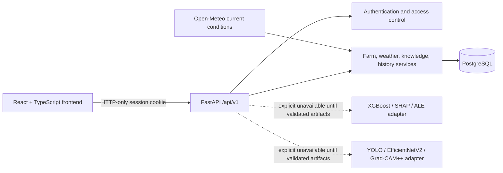

# Architecture

The environmental and image modules are separate. No combined multimodal
classifier is implemented. External weather data is fetched only for a farm
whose user supplied coordinates; provider failure falls back to visibly cached
observations and does not imply freshness.

## Current implementation boundary

Implemented: account registration/login/logout, secure cookie sessions,
user-owned farms, current Open-Meteo observation retrieval and caching, reviewed
knowledge CRUD API, bounded upload validation, rate limiting, health checks,
and explicit model-unavailable responses.

Not implemented: validated model inference, explainability generation,
historical weather backfill, persistent image/object storage, password reset,
account deletion workflow, admin UI/provisioning, PWA/offline inference,
production-grade distributed rate limiting, and full frontend test suite.
