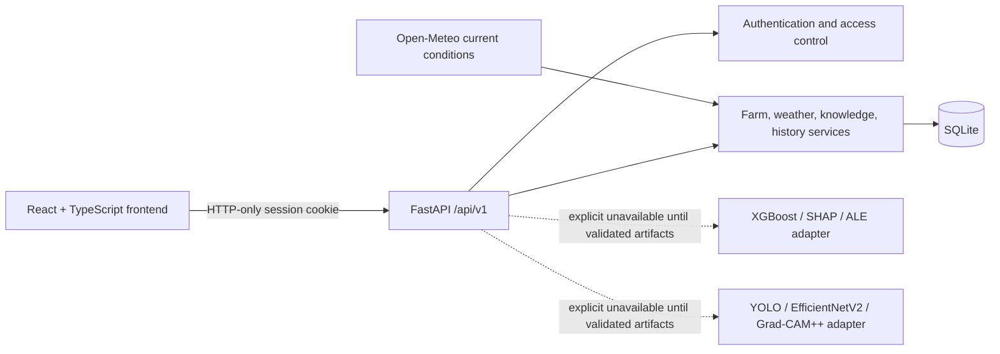

# Architecture

The environmental and image modules are separate for real inference. The
development-only `/demo/fusion/predict` endpoint combines the EfficientNetV2
image scores with explicitly synthetic XGBoost scores for demonstration; its
late-fusion ranking, SHAP values, and ALE plot are not disease predictions and
are never saved to prediction history. It is disabled in production. YOLO is
not used because no suitable bounding-box training data or detector artifact is
available, and the evaluated crop pipeline was rejected for field inference.
Wilt is also omitted from the fused ranking because the image classifier has no
matching Wilt class.

External weather data is fetched only for a farm whose user supplied
coordinates; provider failure falls back to visibly cached observations and
does not imply freshness.

## Current implementation boundary

Implemented: account registration/login/logout, secure cookie sessions,
user-owned farms, current Open-Meteo observation retrieval and caching, reviewed
knowledge CRUD API, bounded upload validation, rate limiting, health checks,
history persistence, audit logging, account deletion, and explicit
model-unavailable responses.

Not implemented: validated environmental-risk inference, YOLO detector inference, production late fusion,
historical weather backfill, persistent image/object storage, password reset,
production account-management UI beyond deletion, PWA/offline inference,
production-grade distributed rate limiting, and full frontend test suite.

Farm records can store one user-permitted GPS point and optional manually
measured soil pH. Current Open-Meteo weather is displayed as context only.
Without matching, verified disease observations and a validated model artifact,
the environmental-risk API does not produce disease scores.
