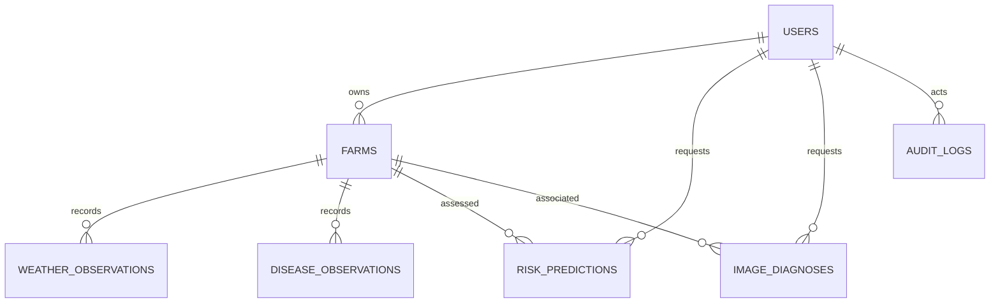

# Database model

SQLAlchemy models and the initial Alembic revision define users, farms,
weather observations, disease observations, risk predictions, image diagnoses,
explanations, disease knowledge, model versions, and audit logs. User and farm
relations use ownership-scoped service queries. UTC timestamps are used by the
application; database drivers may return naive UTC timestamps on SQLite.



`explanations.prediction_id` is intentionally polymorphic and currently has no
database foreign key; split typed explanation tables before relying on
referential integrity for production retention/deletion.

## Local operations

SQLite is selected for the local/prototype deployment. From the repository root:

```powershell
python -m pip install -r backend\requirements.txt
alembic -c backend\alembic.ini upgrade head
```

Database backups, encryption-at-rest, migrations in deployment, and retention
policies must be configured for the chosen hosting environment.
